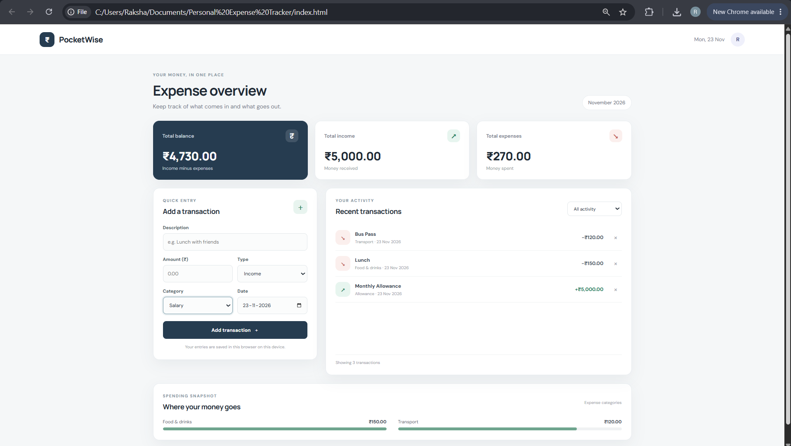
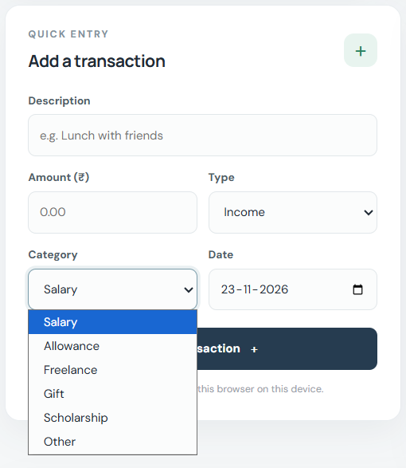
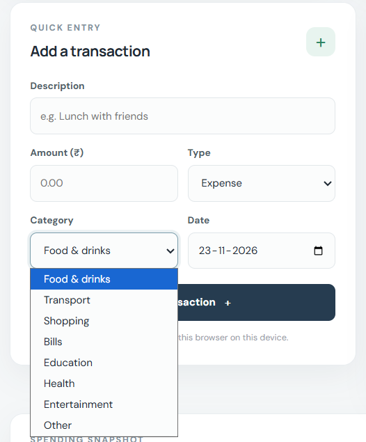

# PocketWise – Personal Expense Tracker
PocketWise is a responsive, browser-based expense tracker built with HTML, CSS and vanilla JavaScript. It helps users record income and expenses, review their balance and see a simple breakdown of spending by category.

## Features
- Add income and expense transactions
- Choose a category and date for each transaction
- Automatically calculate total income, total expenses and balance
- Filter the transaction list by all activity, income or expenses
- Delete individual transactions
- View expense totals by category
- Save transactions in browser localStorage
- Responsive layout for desktop and mobile screens
- Basic form validation, including positive amounts and no future transaction dates

## Built With
- HTML5
- CSS3 (Grid, Flexbox and media queries)
- JavaScript (DOM manipulation, arrays, Intl.NumberFormat and localStorage)

## Run Locally
1. Download or clone this repository.
2. Open the project folder in Visual Studio Code.
3. Open index.html in your browser, or use the Live Server extension.
4. Add a transaction using the form.

No package installation or backend server is required.

## Project Structure
```text
Personal-Expense-Tracker/
├── index.html
├── style.css
├── script.js
└── README.md
```

## Notes and Limitations
- Data is stored locally in the browser.
- Data is not synced between devices or browsers.
- Clearing browser site data can remove saved transactions.
- This is a learning project, not a banking or financial service.

## Author
Raksha S Kalagare


## Screenshots
### Dashboard


### Category Breakdown


